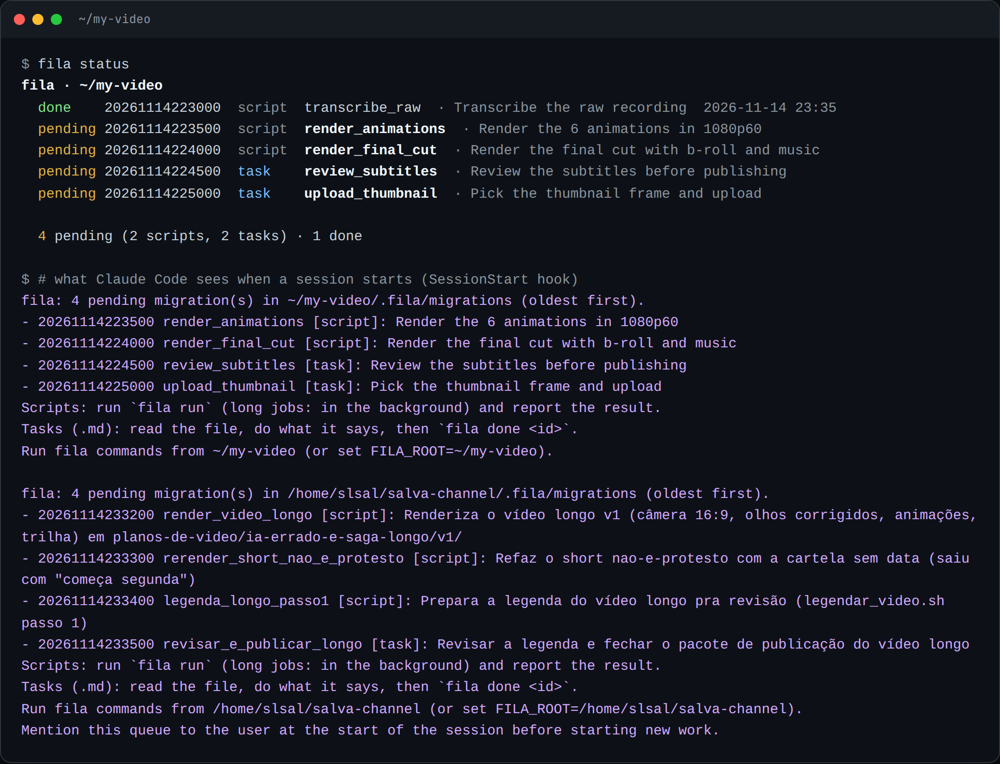

# fila

**A pocket Kafka for Claude Code.**

Rails-style migrations for your pending work: scripts run once and their ids go into an
append-only log, tasks wait for the agent, and the queue shows up every time a session starts.

🇧🇷 [Leia em português](README.pt-BR.md)



You start a long render, a transcription, a batch job. The session ends, the laptop sleeps, you
forget. Next time you open Claude Code, nobody knows what was left half done.

`fila` (Portuguese for *queue*) fixes that with an idea every Rails developer already trusts:
**a migration is something that needs to happen; recording its id is the proof that it happened.**

- Each pending job is a file in `.fila/migrations/`, named `<timestamp>_<name>`.
- `fila run` executes the pending ones **in id order** and appends each id to `.fila/done`, the
  same way Rails writes to `schema_migrations`.
- A failure stops the queue right there. Nothing after it runs, and the failed id is not recorded.
- A **SessionStart hook** tells Claude Code what is still pending as soon as a session opens, so
  the agent picks up where you left off.

Why "pocket Kafka": a Kafka consumer never asks "did I process this?", it reads its committed
offset. `fila` does the same with `.fila/done`, an append-only log of executed ids, which is also
exactly what Rails' `schema_migrations` is. No broker, no partitions, no cluster: one file and a
text log, sized for one person and one agent.

One file, Python 3 standard library only, no daemon, no database. The queue is plain text you can
commit, diff and review.

## Two kinds of migration

| Kind | File | What happens |
|---|---|---|
| **script** | `.sh`, `.py`, or any executable | `fila run` executes it from the project root. Exit 0 = done. |
| **task** | `.md` | Instructions for a person or an AI agent (review, decide, write). Closed with `fila done <id>`. |

Tasks are what makes this useful with an agent: work that needs judgment goes in the queue too,
and Claude Code sees it at the start of the next session.

## Install

### As a Claude Code plugin (recommended)

Inside Claude Code (2.1.275 or later):

```
/plugin install fila --marketplace Salv4d/fila
```

On older versions, two steps: `/plugin marketplace add Salv4d/fila`, then `/plugin install fila@fila`.

That gives you the SessionStart hook, the `fila` command on the agent's PATH, and three slash commands:

| Command | What it does |
|---|---|
| `/fila:status` | Shows the queue and suggests the next step |
| `/fila:new <what>` | Queues new work: Claude decides script or task and writes the file |
| `/fila:run` | Runs the pending scripts (in the background when they are long) and reports |

It works in the terminal, the desktop app and the VS Code extension, because they share the same
settings on a computer. It does not work in claude.ai chat or cloud sessions: there is no local
folder there.

### As a standalone CLI

```bash
curl -fsSL https://raw.githubusercontent.com/Salv4d/fila/main/fila -o ~/.local/bin/fila
chmod +x ~/.local/bin/fila
fila install-hook --global   # inside a project: hook in ~/.claude/settings.json + project registered
```

Use one of the two, not both, or the hook runs twice.

### Windows

Works with Python 3.8+ (`python`, `python3` or the `py` launcher) and Git for Windows, which is
also what Claude Code uses to run hooks. `.py` migrations run anywhere; `.sh` migrations need
bash (Git Bash). CI runs the tests on Linux, macOS and Windows.

## Quick start

```bash
cd my-project
fila init                                  # creates .fila/
fila install-hook                          # adds the SessionStart hook to .claude/settings.json
fila new "render final cut"                # .fila/migrations/20261114224000_render_final_cut.sh
fila new "review subtitles" --md           # a task for a person or the agent
$EDITOR .fila/migrations/*render_final_cut.sh
fila status
fila run                                   # runs pending scripts in order
fila done 20261114224500                   # closes a task
```

A script migration is a normal script. The first comment line is its description:

```bash
#!/usr/bin/env bash
# Render the final cut with b-roll and music
set -euo pipefail
python3 scripts/render.py raw.mkv --out final.mp4
```

## Commands

| Command | What it does |
|---|---|
| `fila init` | Creates `.fila/` (`migrations/`, `done`, `logs/`) in the current directory. |
| `fila new <name> [--md]` | New migration with a timestamp id. `--md` makes a task. |
| `fila status [--json]` | Pending and done, oldest first. `fila` alone does the same. |
| `fila run [ID ...] [--dry-run]` | Runs pending scripts in order. Stops at the first failure. |
| `fila done ID ...` | Records ids without running them (tasks, or work done by hand). |
| `fila undo ID ...` | Puts migrations back in the queue (like a rollback). |
| `fila log ID` | Output of the last run of a migration (`.fila/logs/<id>.log`). |
| `fila hook` | The SessionStart hook. Silent when nothing is pending. |
| `fila install-hook [--global]` | Adds the hook to `.claude/settings.json`. `--global`: to `~/.claude/settings.json`, and registers this project. |
| `fila projects [--remove PATH]` | Lists (or unregisters) the projects the global hook watches. |

IDs accept a unique prefix or the migration name.

## How the hook works

`fila install-hook` adds this to `.claude/settings.json`:

```json
{
  "hooks": {
    "SessionStart": [
      { "hooks": [{ "type": "command", "command": "\"/home/you/.local/bin/fila\" hook", "timeout": 10 }] }
    ]
  }
}
```

When something is pending, `fila hook` prints a short note for you (`fila: 3 pending`) and adds the
list to Claude's context, with instructions: run the scripts, do the tasks, close them with
`fila done`. When nothing is pending it prints nothing, so it costs nothing.

The hook only **reads** the queue. It never runs a migration on its own. Running is always an
explicit `fila run`, by you or by the agent.

## One hook, many projects

If you open Claude Code from your home folder (or anywhere outside the project), a project-level
hook never fires. Run this once inside each project:

```bash
fila install-hook --global
```

It puts the hook in `~/.claude/settings.json` and registers the project in
`~/.config/fila/projects`. From then on, every session, wherever it starts, gets the pending work
of all registered projects. `fila projects` shows the list.

## What goes in git

Commit `.fila/migrations/` and `.fila/done`: that is your history of what was done and when.
`fila init` creates a `.fila/.gitignore` that leaves `logs/` and the run lock out.

## Details

- **Order** is the id (timestamp) order, never file modification time.
- **Working directory** of every script is the project root (the folder that holds `.fila/`),
  even if you call `fila` from a subfolder. Scripts get `FILA_ID` and `FILA_ROOT` in the environment.
- **Concurrency**: a lock file stops two `fila run` at once.
- **Format of `.fila/done`**: one line per id, `id<TAB>ran|marked<TAB>iso-date<TAB>duration`.

## Similar projects, and how fila differs

| Project | What it is | Difference |
|---|---|---|
| [Beads](https://github.com/steveyegge/beads) | Git-backed issue tracker that gives coding agents memory across sessions | Tracks issues (status, priority, dependencies); does not execute anything. `fila` runs scripts once and logs them |
| [Backlog.md](https://github.com/MrLesk/Backlog.md) | Markdown task board for humans and AI agents | A board, not an ordered queue with run-once semantics |
| [Taskmaster AI](https://github.com/eyaltoledano/claude-task-master) | Breaks a PRD into tasks for the agent | Planning; `fila` is about work already decided that still has to happen |
| [scriptup](https://github.com/mg98/scriptup), [TerraRatchet](https://github.com/triptease/terra-ratchet) | Run-once script runners, migration style | Same core idea for scripts, but not agent-aware: no tasks, no session hook |

If you need a full issue tracker for your agent, use Beads. If you need "this has to happen, once,
in this order, and the agent must not forget it", that is `fila`.

## Tests

```bash
python3 -m unittest discover -s tests
```

## License

MIT
