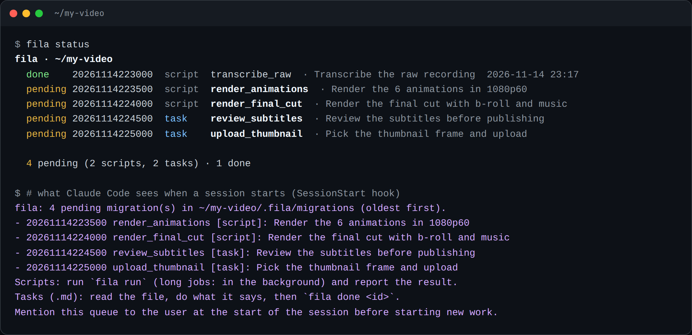

# fila

**Migrations no estilo Rails pro seu trabalho pendente, conferidas toda vez que o Claude Code abre.**

🇺🇸 [Read in English](README.md)



Você começa um render longo, uma transcrição, um processamento em lote. A sessão acaba, o notebook
dorme, você esquece. Na próxima vez que abre o Claude Code, ninguém sabe o que ficou pela metade.

A `fila` resolve isso com uma ideia que todo dev Rails já conhece: **a migration é o que precisa
ser feito; gravar o id dela é a prova de que foi feito.**

- Cada trabalho pendente é um arquivo em `.fila/migrations/`, com nome `<timestamp>_<nome>`.
- `fila run` executa os pendentes **na ordem do id** e anota cada id em `.fila/done`, do mesmo
  jeito que o Rails grava na `schema_migrations`.
- Se um falha, a fila para ali. O que vem depois não roda, e o id que falhou não é anotado.
- Um **hook de SessionStart** conta pro Claude Code o que ainda está pendente assim que a sessão
  abre, e o agente continua de onde você parou.

Um arquivo só, só biblioteca padrão do Python 3, sem serviço rodando, sem banco. A fila é texto
puro: dá pra commitar, comparar e revisar.

## Dois tipos de migration

| Tipo | Arquivo | O que acontece |
|---|---|---|
| **script** | `.sh`, `.py` ou qualquer executável | `fila run` executa a partir da raiz do projeto. Saiu com 0 = feito. |
| **tarefa** | `.md` | Instrução pra uma pessoa ou pra um agente de IA (revisar, decidir, escrever). Fecha com `fila done <id>`. |

As tarefas são o que deixa isso útil com agente: trabalho que precisa de julgamento também entra
na fila, e o Claude Code vê no começo da próxima sessão.

## Instalar

```bash
curl -fsSL https://raw.githubusercontent.com/Salv4d/fila/main/fila -o ~/.local/bin/fila
chmod +x ~/.local/bin/fila
```

Ou clone o repositório e ponha o `fila` em qualquer pasta do seu `PATH`.

## Começo rápido

```bash
cd meu-projeto
fila init                                  # cria .fila/
fila install-hook                          # põe o hook de SessionStart no .claude/settings.json
fila new "render final"                    # .fila/migrations/20261114224000_render_final.sh
fila new "revisar legenda" --md            # tarefa pra uma pessoa ou pro agente
$EDITOR .fila/migrations/*render_final.sh
fila status
fila run                                   # roda os scripts pendentes, em ordem
fila done 20261114224500                   # fecha uma tarefa
```

Migration de script é um script comum. A primeira linha de comentário é a descrição:

```bash
#!/usr/bin/env bash
# Renderiza o corte final com b-roll e música
set -euo pipefail
python3 scripts/render.py bruto.mkv --out final.mp4
```

## Comandos

| Comando | O que faz |
|---|---|
| `fila init` | Cria `.fila/` (`migrations/`, `done`, `logs/`) na pasta atual. |
| `fila new <nome> [--md]` | Migration nova com id de data e hora. `--md` cria uma tarefa. |
| `fila status [--json]` | Pendentes e feitas, da mais antiga pra mais nova. Só `fila` faz o mesmo. |
| `fila run [ID ...] [--dry-run]` | Roda os scripts pendentes em ordem. Para na primeira falha. |
| `fila done ID ...` | Anota ids sem rodar (tarefas, ou coisa feita na mão). |
| `fila undo ID ...` | Devolve migrations pra fila (o "rollback"). |
| `fila log ID` | Saída da última execução (`.fila/logs/<id>.log`). |
| `fila hook` | O hook de SessionStart. Não imprime nada quando não há pendência. |
| `fila install-hook [--global]` | Põe o hook no `.claude/settings.json` (ou no `~/.claude/settings.json`). |

Os ids aceitam um prefixo único ou o nome da migration.

## Como o hook funciona

`fila install-hook` acrescenta isto ao `.claude/settings.json`:

```json
{
  "hooks": {
    "SessionStart": [
      { "hooks": [{ "type": "command", "command": "\"/home/voce/.local/bin/fila\" hook", "timeout": 10 }] }
    ]
  }
}
```

Quando tem pendência, `fila hook` mostra um aviso curto pra você (`fila: 3 pending`) e coloca a
lista no contexto do Claude, com a instrução: rodar os scripts, fazer as tarefas e fechar com
`fila done`. Sem pendência, não imprime nada e não custa nada.

O hook só **lê** a fila. Nunca roda migration sozinho. Rodar é sempre um `fila run` explícito,
seu ou do agente.

## O que vai pro git

Commite `.fila/migrations/` e `.fila/done`: é o histórico do que foi feito e quando. O
`fila init` cria um `.fila/.gitignore` que deixa `logs/` e a trava de execução de fora.

## Detalhes

- **Ordem** é a do id (timestamp), nunca a data de modificação do arquivo.
- **Pasta de trabalho** de todo script é a raiz do projeto (a pasta que tem a `.fila/`), mesmo
  chamando `fila` de uma subpasta. Os scripts recebem `FILA_ID` e `FILA_ROOT` no ambiente.
- **Concorrência**: um arquivo de trava impede dois `fila run` ao mesmo tempo.
- **Formato do `.fila/done`**: uma linha por id, `id<TAB>ran|marked<TAB>data-iso<TAB>duração`.

## Testes

```bash
python3 -m unittest discover -s tests
```

## Licença

MIT
